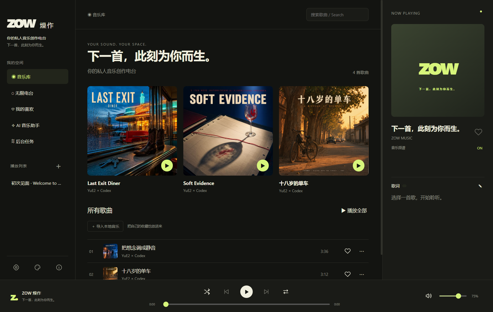

# ZOW 燥作

**你的私人音乐创作电台。下一首，此刻为你而生。**

ZOW 是一款 Windows 桌面应用，把聊天创作、本地音乐生成和日常听歌放在同一个窗口里。说出心情、风格或今天发生的事，让 AI 规划歌曲；音频生成后立即入库播放，封面与歌词时间对齐在后台补全。

[官网与作者介绍](https://zowai.cn/) · [问题反馈](https://github.com/lxcyril-wj/zow-music/issues)



## 能做什么

- **无限电台**：收藏偏好、语种、风格、场景、情感、主题和碎碎念共同参与规划。先生成两首，再五首、十首；待播不足时继续补充。中途更新条件只影响后续，之前生成的歌曲保留。每日电台单独保存为播放列表。
- **AI 音乐助手**：多个创作会话；公开处理步骤和进度；可以选择服务、模型和思考强度，并记住上次选择。通过 Pi 接入受支持的账号授权、API 与兼容接口；本地 Ollama 可使用兼容接口。语言模型服务须由用户自行配置。
- **本地音乐库**：导入默认复制到曲库，支持喜欢、播放列表、歌词编辑、频谱和九套皮肤。删除播放列表不会删除歌曲。
- **模块化生成**：YuE2 音乐、MOSS 封面、Whisper 与 Qwen 0.6B 歌词时间对齐。工作流由独立 JSON 模块维护；批次完成后释放模型。
- **便携使用**：解压后双击 ZOW.exe，不需要安装程序。默认中文，可切换英文。

## 下载与使用

首版为 **0.1.0 预览版**。

**[下载 Windows 完整便携版（夸克网盘）](https://pan.quark.cn/s/2dc19de39025)** · [版本发布说明](https://github.com/lxcyril-wj/zow-music/releases/tag/v0.1.0)

完整便携版包含独立运行环境与最小模型，无需安装。共 **5 个 7z 分卷，总计约 19.56GB**，前四卷各 4GiB，最后一卷较小；解压后约 24.31GB。请下载全部分卷到同一文件夹，保持文件名不变，用最新版 7-Zip 从 `ZOW-0.1.0-Windows-x64-Full.7z.001` 开始解压，再双击完整目录中的 `ZOW.exe`。网盘内附上传与解压说明、`SHA256SUMS.txt` 和模型校验记录。

GitHub 源码不包含用户数据、Python 环境或模型权重。

1. 把完整程序目录解压到可写位置，建议短的英文路径；不要只复制 EXE。
2. 双击 ZOW.exe。首次启动自动建立自己的 Data 并导入四首中英文演示歌曲。
3. 在“设置 → 模型与账号”连接你自己的语言模型服务。
4. 需要安装模块时，在对应缺失项点击安装；完整便携版已带标准模型。
5. 打开“AI 音乐助手”或“无限电台”创作，歌曲完成后即可播放。

播放器不要求显卡；**本地生成需要兼容的 NVIDIA 显卡及驱动**。完整包使用 PyTorch 2.9.1 / CUDA 13，实机验证为 RTX 4090 24GB（SM89）；其他显卡的速度、显存与驱动兼容性尚未逐一验证，不承诺全显卡即开即用。程序不包含显卡驱动，也不内置语言模型账号。模型生成耗时与硬件、歌曲时长有关。

## 数据与更新

打包程序的数据在 EXE 同目录的 Data，开发运行的数据在项目 data。账号、歌曲、封面、歌词、时间轴、聊天、每日歌单都保存在本机。发布包不包含作者的账号和私人曲库。

更新前退出程序，保留整个 Data，再更新程序文件。不要用他人的 Data 覆盖自己的数据。缓存清理保留曲库成品和列表；账号凭据由 Windows 加密，换电脑后需重新登录。

## 从源码运行

Windows x64，Node.js 22.19 或更新版本：

```powershell
npm ci
npm test
npm start
```

构建可运行目录：

```powershell
npm run build
```

输出在 dist/win-unpacked。`npm run release:zip` 生成不含 Data 的程序压缩包。开发依赖、构建产物、运行环境和用户数据不要提交到仓库。

模块扩展见 [模块开发](docs/模块开发.md)，许可和模型来源见 [第三方组件](docs/第三方组件.md) 与 [发布说明](docs/发布说明.md)。

## 许可

原创程序代码采用 [MIT](LICENSE)。第三方程序和模型各按自己的许可分发，不能把整个整合包统称为 MIT。**YuE2 权重采用 CC BY-NC 4.0，仅限符合该许可的非商业用途**；MOSS 和 Qwen 权重为 Apache 2.0，Whisper 权重为 MIT。示例媒体的授权范围见 [示例说明](assets/demo/NOTICE.md)。模型输出也不能被承诺为永不重复或自动无版权争议。

## 当前验证范围

发布前通过48项自动测试，并对编译后的电台/皮肤、聊天和播放器分别完成9组回归；包含换条件保留旧歌、跨日归档、模型记忆、皮肤持久化和小窗口布局。部分流程使用隔离模拟，不能代替对所有硬件和模型配置的实机生成测试。
